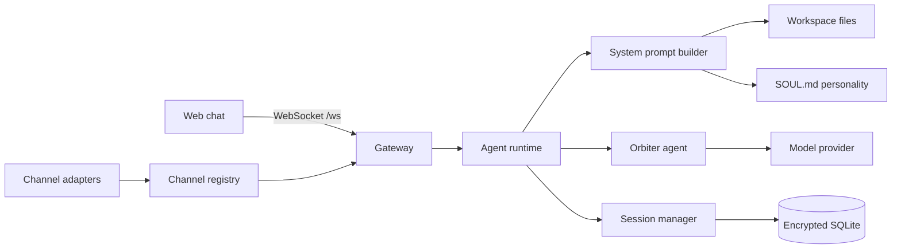

# orbiter-claw

A personal AI assistant that runs on your own machine. It keeps your conversations in an encrypted local database, takes its personality and memory from markdown files in a workspace folder, and talks to you over a WebSocket gateway with a web chat page on top.

It is built on Orbiter, Midsphere's agent framework, which is now called [Exo](https://github.com/midsphere-ai/exo).

## What it does

- Runs a FastAPI server with a WebSocket gateway at `/ws` and 16 HTTP endpoints under `/api`.
- Stores sessions and messages in SQLite. Message content is encrypted with Fernet, and the key comes from your passphrase through PBKDF2 with 600,000 iterations.
- Streams model replies token by token through an Orbiter agent. Models are named as `provider:model`, for example `openai:gpt-4o`.
- Builds the system prompt from workspace files: `SOUL.md`, `AGENTS.md`, `USER.md`, `IDENTITY.md`, `TOOLS.md` and `MEMORY.md`. The builder has three modes: full, minimal and none.
- Watches `SOUL.md` and reloads the personality when the file changes.
- Loads channel adapters as plugins, from Python entry points or from a folder, and configures them from TOML.
- Serves a chat page written in Astro, with markdown rendering, code highlighting and a dark theme.

The Python package is 2,689 lines with 379 tests across 9 test files. The web chat has a Playwright test.

## How it works



## Layout

| Path | What is in it |
|---|---|
| `src/orbiter_claw/app.py` | App factory, routers, CORS |
| `src/orbiter_claw/gateway.py` | WebSocket gateway, message envelope, connection manager |
| `src/orbiter_claw/agent_runtime.py` | Runs the agent and streams replies |
| `src/orbiter_claw/prompt_builder.py` | System prompt assembly |
| `src/orbiter_claw/personality.py` | `SOUL.md` parsing and hot reload |
| `src/orbiter_claw/workspace.py` | Workspace memory files |
| `src/orbiter_claw/sessions.py` | Sessions and messages |
| `src/orbiter_claw/database.py`, `encryption.py`, `migrations/` | Encrypted SQLite and schema migrations |
| `src/orbiter_claw/channels/` | Channel adapter interface and plugin registry |
| `src/orbiter_claw/routes/` | HTTP API |
| `tests/` | pytest suite |
| `web/` | Astro chat frontend |

## Setup

You need Python 3.11 or newer, [uv](https://docs.astral.sh/uv/) and Node 20 or newer. `pyproject.toml` expects the Orbiter packages in a sibling folder at `../orbiter-ai/packages`.

```bash
uv sync --extra dev
uv run uvicorn orbiter_claw.app:create_app --factory --port 8000
uv run pytest

cd web
npm install
npm run dev
```

## Environment variables

| Variable | Purpose |
|---|---|
| `ORBITER_CLAW_KEY` | Passphrase used to derive the database encryption key |
| `ORBITER_CLAW_DB_PATH` | Path to the SQLite file |

Model provider keys are read by Orbiter, for example `OPENAI_API_KEY`.

## Status

Built in February 2026. The gateway, sessions, agent runtime, encryption, prompt builder, personality, workspace memory, web chat and channel plugin system are done. Individual channel adapters such as Telegram or Discord were planned next. Midsphere AI wound down in 2026. This is published as it was and is not maintained.

## Licence

[MIT](LICENSE). Free to use, change, self-host and build on, including commercially. The Junicode font in `web/public/fonts` is under the SIL Open Font License.

Thanks to OpenClaw, FastAPI, Astro and Junicode.
